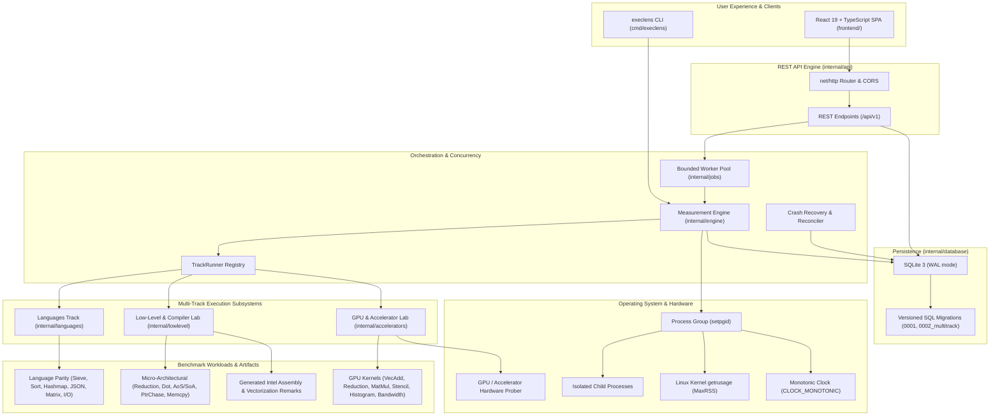

# ExecLens

> **Measure fairly. Compare deeply. Understand why.**

[](https://github.com/execlens/execlens/actions/workflows/ci.yml)
[](LICENSE)
[](https://golang.org)
[](https://react.dev)
[](https://www.typescriptlang.org)

**ExecLens** is an open-source systems performance benchmarking platform engineered to compare equivalent computational workloads across programming languages, CPU micro-architectural configurations, and GPU accelerators under strictly controlled, transparent, and reproducible conditions.

ExecLens rejects simplistic, misleading claims that one programming language or paradigm is universally the fastest. Instead, it provides a high-precision measurement engine, an interactive visual explorer, and statistical analysis across three specialized performance engineering tracks:

1. **Languages Track**: Fair comparisons across 6 runtimes (C++, Rust, Go, Java, Python, Node.js) across 6 deterministic parity workloads.
2. **Low-Level Code & Compiler Explorer Lab**: Micro-architectural studies (scalar vs compiler auto-vectorization vs explicit AVX2 intrinsics vs inline x86_64 assembly vs OpenMP; AoS vs SoA layouts; pointer chasing vs contiguous access; memory copy techniques) and compiler comparisons (GCC vs Clang, `-O0` to `-Ofast`, Intel-syntax assembly generation, and vectorization diagnostic remarks).
3. **CUDA & GPU Compute Lab**: Accelerated execution with device telemetry, pure kernel duration (`cudaEvent_t`), PCIe host-to-device and device-to-host transfers, allocation overhead, effective bandwidth (GB/s), GFLOPS, and CPU reference baselines. Truthful detection of CUDA, OpenCL, SYCL, and ROCm/HIP.

---

## Architecture Overview



---

## Key Features

### 1. Multi-Track Performance Engineering Platform
- **Track 1: Programming Languages Track**
  - **6 Supported Runtimes**: C++ (GCC `-O3`), Rust (`rustc -C opt-level=3`), Go (`go build`), Java (OpenJDK HotSpot JIT), Python (CPython 3), JavaScript (Node.js V8).
  - **6 Deterministic Parity Workloads**: Sieve of Eratosthenes, Integer Sorting (Quicksort vs stdlib), Hash Map operations, JSON processing, Matrix multiplication, File streaming I/O with SHA-256 digest.
- **Track 2: Low-Level Code & Compiler Explorer Lab**
  - **Micro-Architectural Variants**:
    - Scalar baseline vs compiler auto-vectorization (`-O3 -mavx2 -mfma`).
    - Explicit SIMD intrinsics (AVX2 / FMA `_mm256_*`).
    - Inline x86_64 assembly (`vaddps`, `vmulps`, etc.).
    - Multi-threaded OpenMP parallel loops.
    - Array of Structures (AoS) vs Structure of Arrays (SoA) memory layouts.
    - Contiguous array streaming vs pointer-chasing cycles (prefetcher-defeating).
    - Memory copy mechanisms: glibc `memcpy` vs scalar byte copy vs unrolled 64-bit copy vs 32-byte aligned AVX2 non-temporal streaming stores (`_mm256_stream_si256`).
  - **Compiler Explorer**:
    - GCC (`g++`) vs Clang (`clang++`) side-by-side comparison on identical C++ source.
    - Optimization levels: `-O0`, `-O1`, `-O2`, `-O3`, `-Ofast`.
    - Automated Intel-syntax assembly generation (`-S -masm=intel`).
    - Compiler vectorization remark extraction (`-fopt-info-vec-optimized` for GCC, `-Rpass=loop-vectorize` for Clang).
    - Executable binary size tracking and comparison.
- **Track 3: CUDA & GPU Compute Lab**
  - **6 Dedicated CUDA Workloads**:
    - Vector Addition & SAXPY.
    - Parallel Reduction (shared memory tree reduction & warp shuffle unrolling).
    - Matrix Multiplication (naïve global memory vs $16 \times 16$ tiled shared memory vs cache-blocked CPU reference).
    - 1D Convolution / Stencil computation with shared memory halo caching.
    - 256-bin Histogram with shared memory atomic updates.
    - PCIe Memory Bandwidth: Pageable host memory vs Pinned host memory (`cudaHostAlloc`).
  - **Hardware & Telemetry Tracking**: GPU model, Compute Capability, Driver and Toolkit versions, Grid/Block dimensions, Effective Bandwidth (GB/s), and GFLOPS.
  - **Honest Hardware Detection**: Probing registry for CUDA, OpenCL, SYCL, and ROCm/HIP. Truthful diagnostics on toolchain/device capability mismatches (never fabricates GPU numbers or silently substitutes CPU).

### 2. Measurement Engine & Rigor
- Independent tracking of compilation time vs steady-state execution time.
- Correctness validation prior to accepting timing measurements.
- OS-level peak resident set size (MaxRSS) memory tracking.
- Complete descriptive statistics: Median, Mean, Sample Standard Deviation, CV%, IQR, Throughput, and Student's t 95% Confidence Intervals.
- Fine-grained GPU execution breakdown: Allocation, Host-to-Device transfer, pure kernel duration (`cudaEvent_t`), Device-to-Host transfer, and end-to-end wall-clock time.

### 3. Process Isolation & Security
- Fixed executable paths with explicit argument arrays (no shell string interpolation).
- Isolated process groups (`setpgid`) with automatic group killing (`SIGKILL`) on timeout or user cancellation.
- Bounded concurrency to eliminate core contention and cache thrashing.
- Sanitized environment variables preventing credential leakage.

### 4. Interactive Web Dashboard
- React 19 + TypeScript + Vite single-page application.
- Multi-track launch modal supporting Languages, Low-Level CPU, and GPU tracks with live variant selection and compiler choices.
- Interactive Recharts bar charts for execution time, relative speedup, peak memory, throughput, and GPU bandwidth/GFLOPS.
- Dynamic baseline selection for instant speedup recalculation.
- Assembly & Optimization Remarks visual inspector with copy and syntax display.
- Side-by-side run comparison with compatibility warnings.
- Markdown report export and downloadable JSON/CSV datasets.
- Dark and Light mode themes.

### 5. Unified CLI Tool (`execlens`)
- Comprehensive CLI commands for server execution, ad-hoc multi-language runs, low-level CPU experiments, CUDA executions, and accelerator discovery.

---

## Prerequisites

To run ExecLens locally, ensure the following are installed:

- **Go**: 1.22+ (recommended 1.24+)
- **Node.js & npm**: Node.js 18+ and npm 9+
- **Compilers / Runtimes** (for full multi-language benchmarks):
  - `g++` (GCC 11+)
  - `rustc` (Rust 1.70+)
  - `javac` and `java` (OpenJDK 17+)
  - `python3` (Python 3.10+)
  - `node` (Node.js 18+)

> **Note**: Missing runtimes are detected gracefully. ExecLens clearly reports unavailable runtimes and enables benchmarks for all installed toolchains.

---

## Quickstart

### 1. Build ExecLens

```bash
# Clone the repository
git clone https://github.com/execlens/execlens.git
cd execlens

# Build frontend and binary using Makefile
make build
```

This compiles the React frontend to `frontend/dist` and compiles the Go backend binary `execlens`.

### 2. Launch the Web Dashboard

```bash
./execlens server --port 8080
```

Open your browser to `http://localhost:8080`. The embedded web dashboard will load immediately, pre-configured with local API endpoints and SQLite storage.

### 3. Run a Benchmark via CLI

You can also run benchmarks directly from the command line without launching the server:

```bash
# Track 1: Run cross-language benchmark (Sieve across all available languages)
./execlens run --workload=sieve --languages=cpp,rust,go,java,python,javascript --iterations=5 --warmup=2

# Track 1: Run integer sorting benchmark comparing Quicksort implementations
./execlens run --workload=sort --languages=cpp,rust,go,python,javascript,java --iterations=3 --mode=quicksort

# Track 2: Run CPU Low-Level & Compiler Lab (scalar vs autovec vs SIMD AVX2 vs OpenMP vs inline asm)
./execlens lowlevel --workload=lowlevel_reduction --compiler=gcc --opt=O3 --variants=scalar,autovec,simd_avx2,openmp,asm

# Track 2: Compare memory layout performance (Array of Structures vs Structure of Arrays)
./execlens lowlevel --workload=lowlevel_layout --variants=aos,soa --compiler=clang --opt=O3

# Track 2: Compare memory copying mechanisms (glibc memcpy vs scalar vs unrolled vs AVX2 non-temporal streaming)
./execlens lowlevel --workload=lowlevel_memcpy --variants=memcpy,scalar,unroll64,avx2_stream

# Track 3: Run CUDA GPU benchmark with CPU reference baseline
./execlens cuda --workload=cuda_vec_add_saxpy --size=16777216

# Track 3: Run GPU matrix multiplication comparing naive global memory vs 16x16 tiled shared memory
./execlens cuda --workload=cuda_matrix_mul --dim=1024

# Track 3: Benchmark PCIe transfer bandwidth (Pageable vs Pinned host memory)
./execlens cuda --workload=cuda_bandwidth_transfer --size=67108864

# Inspect detected GPU and accelerator hardware backends (CUDA, OpenCL, SYCL, HIP)
./execlens accelerators

# Inspect host language runtime availability
./execlens languages

# List available cross-language workloads and parameters
./execlens workloads
```

---

## Testing & Quality Assurance

ExecLens includes comprehensive test suites across all layers:

```bash
# Run Go unit tests with race detection
make test-unit

# Run end-to-end integration tests
make test-integration

# Run frontend unit tests (Vitest + React Testing Library)
npm --prefix frontend test

# Run linters
make lint

# Run the automated end-to-end smoke test
make smoke
```

---

## REST API Reference

ExecLens exposes a versioned REST API (`/api/v1`):

| Method | Endpoint | Description |
| :--- | :--- | :--- |
| `GET` | `/api/v1/health` | Service health status and timestamp. |
| `GET` | `/api/v1/stats` | Dashboard summary counters, active runtimes, and track stats. |
| `GET` | `/api/v1/tracks` | Multi-track overview with catalog and hardware status. |
| `GET` | `/api/v1/languages` | Supported languages and detected host toolchain versions. |
| `GET` | `/api/v1/workloads` | Catalog of cross-language benchmark workloads, parameters, and caveats. |
| `GET` | `/api/v1/lowlevel/catalog` | Catalog of CPU low-level workloads, variants, and compilers. |
| `GET` | `/api/v1/accelerators` | Probed accelerator devices (CUDA, OpenCL, SYCL, HIP) and diagnostics. |
| `GET` | `/api/v1/accelerators/catalog` | Catalog of GPU accelerator workloads and telemetry requirements. |
| `GET` | `/api/v1/runs` | Paginated benchmark history (`?limit=20&offset=0&track=...&status=...`). |
| `POST` | `/api/v1/runs` | Validate and create a new benchmark run (Languages, Low-Level, or GPU). |
| `GET` | `/api/v1/runs/{id}` | Detailed run metrics, executions, compiler assembly, and GPU breakdowns. |
| `POST` | `/api/v1/runs/{id}/cancel` | Cancel an active benchmark job. |
| `GET` | `/api/v1/runs/{id}/export` | Export run results in JSON or CSV (`?format=json\|csv`). |
| `GET` | `/api/v1/runs/{id}/report` | Retrieve formatted Markdown report. |
| `GET` | `/api/v1/compare` | Compare 2+ runs side-by-side (`?run_ids=id1,id2`). |

---

## Docker & Containerized Execution

ExecLens provides a production-ready, multi-stage `Dockerfile` containing all six language toolchains and a `compose.yaml`:

```bash
# Build and run containerized ExecLens
docker compose up --build -d

# Open dashboard in browser
open http://localhost:8080
```

---

## Extending ExecLens

### Adding a New Language Adapter
1. Implement the `languages.LanguageAdapter` interface in `internal/languages/`.
2. Declare toolchain detection commands, compilation commands, execution vectors, timeouts, and warm-up policies.
3. Register the adapter in `internal/languages/registry.go`.
4. Add corresponding benchmark workload implementations in `benchmarks/<language>/`.

### Adding a New Workload
1. Define a new `workloads.WorkloadContract` in `internal/workloads/workload.go`.
2. Specify input parameters, expected output validation rules, dataset generation (if applicable), and fairness caveats.
3. Implement the workload program in all supported language directories under `benchmarks/`.

---

## Documentation

- [System Architecture Guide](docs/ARCHITECTURE.md)
- [Benchmarking Methodology & Statistical Rigor](docs/METHODOLOGY.md)

---

## License

ExecLens is released under the [MIT License](LICENSE).
