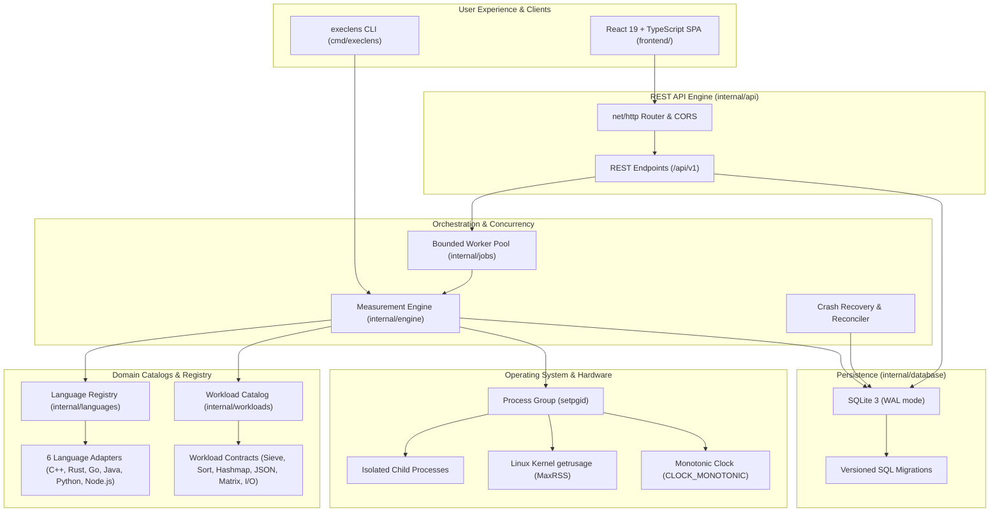

# ExecLens

> **Measure fairly. Compare deeply. Understand why.**

[](https://github.com/execlens/execlens/actions/workflows/ci.yml)
[](LICENSE)
[](https://golang.org)
[](https://react.dev)
[](https://www.typescriptlang.org)

**ExecLens** is an open-source systems performance benchmarking platform engineered to compare equivalent computational workloads across multiple programming languages under strictly controlled, transparent, and reproducible conditions.

ExecLens rejects simplistic, misleading claims that one programming language is universally the fastest. Instead, it provides a high-precision measurement engine, an interactive visual explorer, and statistical analysis to uncover *why* execution times, memory footprints, and scaling characteristics differ.

---

## Architecture Overview



---

## Key Features

- **6 Supported Programming Languages**:
  1. **C++**: Native compiled execution via GCC/G++ (`-O3 -std=c++20`).
  2. **Rust**: Native compiled execution via `rustc` (`-C opt-level=3`).
  3. **Go**: Statically compiled binary via `go build -trimpath`.
  4. **Java**: JVM execution via OpenJDK (`-XX:+TieredCompilation`) with warm-up.
  5. **Python**: Interpreter execution via CPython (`python3 -u`).
  6. **JavaScript**: V8 runtime execution via Node.js with warm-up.
- **6 Deterministic Workloads**:
  1. **Sieve of Eratosthenes**: Prime number calculation measuring tight loop boolean indexing and CPU branch prediction.
  2. **Integer Sorting**: Deterministic 32-bit pseudo-random array sorting with both identical algorithmic Quicksort and runtime standard library modes.
  3. **Hash Map Operations**: High-throughput key-value insertions, lookups, and collision handling.
  4. **JSON Processing**: Decoding, filtering, and field aggregation of structured synthetic documents.
  5. **Matrix Multiplication**: Contiguous row-major double-precision floating point matrix multiplication.
  6. **File Streaming I/O**: Buffered 64KB file read operations coupled with SHA-256 cryptographic digest calculation.
- **Measurement Engine**:
  - Independent tracking of compilation time vs steady-state execution time.
  - Correctness validation prior to accepting timing measurements.
  - OS-level peak resident set size (MaxRSS) memory tracking.
  - Descriptive statistics: Median, Mean, Sample Standard Deviation, CV%, IQR, Throughput, and Student's t 95% Confidence Intervals.
- **Process Isolation & Security**:
  - Fixed executable paths with explicit argument arrays (no shell string interpolation).
  - Isolated process groups (`setpgid`) with automatic group killing (`SIGKILL`) on timeout or user cancellation.
  - Bounded concurrency to eliminate core contention and cache thrashing.
  - Sanitized environment variables preventing credential leakage.
- **Interactive Web Dashboard**:
  - React 19 + TypeScript + Vite single-page application.
  - Interactive Recharts bar charts for execution time, relative speedup, peak memory, and throughput.
  - Dynamic baseline selection for instant speedup recalculation.
  - Side-by-side run comparison with compatibility warnings.
  - Markdown report export and downloadable JSON/CSV datasets.
  - Dark and Light mode themes.
- **Unified CLI Tool (`execlens`)**:
  - Full CLI support for server execution, ad-hoc benchmark runs, runtime inspection, and data exporting.

---

## Prerequisites

To run ExecLens locally, ensure the following are installed:

- **Go**: 1.22+ (recommended 1.24+)
- **Node.js & npm**: Node.js 18+ and npm 9+
- **Compilers / Runtimes** (for full multi-language benchmarks):
  - `g++` (GCC 11+)
  - `rustc` (Rust 1.70+)
  - `javac` and `java` (OpenJDK 17+)
  - `python3` (Python 3.10+)
  - `node` (Node.js 18+)

> **Note**: Missing runtimes are detected gracefully. ExecLens clearly reports unavailable runtimes and enables benchmarks for all installed toolchains.

---

## Quickstart

### 1. Build ExecLens

```bash
# Clone the repository
git clone https://github.com/execlens/execlens.git
cd execlens

# Build frontend and binary using Makefile
make build
```

This compiles the React frontend to `frontend/dist` and compiles the Go backend binary `execlens`.

### 2. Launch the Web Dashboard

```bash
./execlens server --port 8080
```

Open your browser to `http://localhost:8080`. The embedded web dashboard will load immediately, pre-configured with local API endpoints and SQLite storage.

### 3. Run a Benchmark via CLI

You can also run benchmarks directly from the command line without launching the server:

```bash
# Run Sieve of Eratosthenes across all available languages
./execlens run --workload=sieve --languages=cpp,rust,go,java,python,javascript --iterations=5 --warmup=2

# Run integer sorting benchmark comparing Quicksort implementations
./execlens run --workload=sort --languages=cpp,rust,go,python,javascript,java --iterations=3 --mode=quicksort

# Inspect host runtime availability
./execlens languages

# List available workloads and parameters
./execlens workloads
```

---

## Testing & Quality Assurance

ExecLens includes comprehensive test suites across all layers:

```bash
# Run Go unit tests with race detection
make test-unit

# Run end-to-end integration tests
make test-integration

# Run frontend unit tests (Vitest + React Testing Library)
npm --prefix frontend test

# Run linters
make lint

# Run the automated end-to-end smoke test
make smoke
```

---

## REST API Reference

ExecLens exposes a versioned REST API (`/api/v1`):

| Method | Endpoint | Description |
| :--- | :--- | :--- |
| `GET` | `/api/v1/health` | Service health status and timestamp. |
| `GET` | `/api/v1/stats` | Dashboard summary counters and active runtimes. |
| `GET` | `/api/v1/languages` | Supported languages and detected host toolchain versions. |
| `GET` | `/api/v1/workloads` | Catalog of benchmark workloads, parameters, and caveats. |
| `GET` | `/api/v1/runs` | Paginated benchmark history (`?limit=20&offset=0&status=...`). |
| `POST` | `/api/v1/runs` | Validate and create a new benchmark run. |
| `GET` | `/api/v1/runs/{id}` | Detailed run metrics and executions (`?baseline=cpp`). |
| `POST` | `/api/v1/runs/{id}/cancel` | Cancel an active benchmark job. |
| `GET` | `/api/v1/runs/{id}/export` | Export run results in JSON or CSV (`?format=json\|csv`). |
| `GET` | `/api/v1/runs/{id}/report` | Retrieve formatted Markdown report. |
| `GET` | `/api/v1/compare` | Compare 2+ runs side-by-side (`?run_ids=id1,id2`). |

---

## Docker & Containerized Execution

ExecLens provides a production-ready, multi-stage `Dockerfile` containing all six language toolchains and a `compose.yaml`:

```bash
# Build and run containerized ExecLens
docker compose up --build -d

# Open dashboard in browser
open http://localhost:8080
```

---

## Extending ExecLens

### Adding a New Language Adapter
1. Implement the `languages.LanguageAdapter` interface in `internal/languages/`.
2. Declare toolchain detection commands, compilation commands, execution vectors, timeouts, and warm-up policies.
3. Register the adapter in `internal/languages/registry.go`.
4. Add corresponding benchmark workload implementations in `benchmarks/<language>/`.

### Adding a New Workload
1. Define a new `workloads.WorkloadContract` in `internal/workloads/workload.go`.
2. Specify input parameters, expected output validation rules, dataset generation (if applicable), and fairness caveats.
3. Implement the workload program in all supported language directories under `benchmarks/`.

---

## Documentation

- [System Architecture Guide](docs/ARCHITECTURE.md)
- [Benchmarking Methodology & Statistical Rigor](docs/METHODOLOGY.md)

---

## License

ExecLens is released under the [MIT License](LICENSE).
