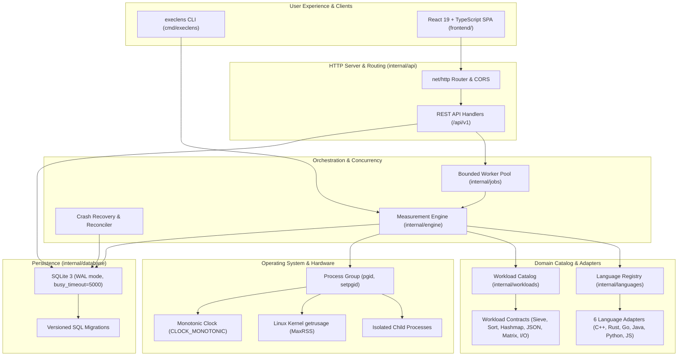

# ExecLens System Architecture

## Overview

**ExecLens** is a production-grade, open-source systems performance benchmarking platform engineered to measure and compare equivalent computational workloads across programming languages under controlled, transparent, and reproducible conditions.

---

## 1. Architectural Principles

1. **Separation of Compilation and Execution**:
   Compilation and preparatory phases are tracked independently (`build_duration_ns`) and never conflated with steady-state algorithmic execution duration.
2. **Deterministic Correctness Validation**:
   Prior to recording any timed repetitions, the execution engine validates output correctness against an expected contract. If validation fails, timing is rejected and marked `FAILED`.
3. **Transparent Statistics & Noise Awareness**:
   ExecLens reports central tendencies (median and mean), sample standard deviation, coefficient of variation (CV%), and Student's t 95% confidence intervals. It flags whether observed differences exceed practical thresholds (5%) or are within measurement noise.
4. **Security & Process Boundaries**:
   Subprocesses are invoked via fixed binary paths and argument vectors (no shell string interpolation). Child processes are isolated in separate process groups (`setpgid: true`) to ensure that cancellations and timeouts immediately clean up the entire process tree without leaving orphaned processes.

---

## 2. Component Breakdown

### A. CLI (`cmd/execlens`)
The unified command-line entry point supporting:
- `execlens server`: Starts the REST API service and embedded dashboard.
- `execlens run`: Directly executes benchmark workloads from the terminal and outputs formatted Markdown tables and metrics summaries.
- `execlens languages`: Probes host compilers and runtimes.
- `execlens workloads`: Inspects the workload catalog.
- `execlens list`: Queries past benchmark runs.
- `execlens report <id>`: Displays detailed markdown reports.
- `execlens export <id> --format=json|csv`: Generates data exports.

### B. REST API Layer (`internal/api`)
Built using Go standard library HTTP routing with parameter validation:
- `GET /api/v1/health`
- `GET /api/v1/stats`
- `GET /api/v1/languages`
- `GET /api/v1/workloads`
- `GET /api/v1/runs` (paginated, with workload and status filtering)
- `POST /api/v1/runs` (input validation, creates run and enqueues to worker pool)
- `GET /api/v1/runs/{runId}` (retrieves run details and on-the-fly relative metrics)
- `POST /api/v1/runs/{runId}/cancel`
- `GET /api/v1/runs/{runId}/export?format=json|csv`
- `GET /api/v1/runs/{runId}/report`
- `GET /api/v1/compare?run_ids=...` (multi-run comparative analysis with compatibility checks)

### C. Bounded Worker Pool (`internal/jobs`)
Limits concurrent benchmark executions (default: 1) to eliminate CPU core contention and cache thrashing. Coordinates job lifecycle, supports graceful context cancellation, and traps unexpected worker panics to prevent service termination.

### D. Measurement Engine (`internal/engine`)
Executes the benchmark lifecycle for each language:
1. Probes toolchain availability and versions.
2. Compiles source code (if compiled language).
3. Executes correctness validation pass.
4. Executes warm-up iterations (tagged `is_warmup: true`).
5. Executes measured repetitions (tagged `is_warmup: false`).
6. Queries Linux kernel `rusage.Maxrss` for peak physical memory.
7. Computes descriptive statistics and 95% confidence intervals.

### E. Language Registry & Adapters (`internal/languages`)
Modular adapter interface defining toolchain requirements, build commands, execution flags, timeouts, and warm-up policies for:
- **C++**: Native compiled execution via GCC/G++ `-O3 -std=c++20`.
- **Rust**: Native compiled execution via `rustc -C opt-level=3 -C codegen-units=1`.
- **Go**: Statically compiled binary via `go build -trimpath`.
- **Java**: JVM execution via OpenJDK `javac -d` and `java -XX:+TieredCompilation` with warm-up.
- **Python**: Interpreter execution via CPython `python3 -u`.
- **JavaScript**: V8 runtime execution via Node.js with warm-up.

### F. Workload Catalog & Contracts (`internal/workloads`)
Catalog of 6 deterministic workloads with explicit validation contracts:
1. `sieve`: Prime counting using Sieve of Eratosthenes (CPU and boolean array traversal).
2. `sort`: 32-bit integer array sorting with deterministic LCG generator (quicksort vs stdlib modes).
3. `hashmap`: String-to-integer hash table insertions and lookups (allocation, hashing, collision handling).
4. `json_proc`: Deserialization, filtering, and aggregation of synthetic JSON documents.
5. `matrix`: Double-precision NxN matrix multiplication ($O(N^3)$ tight nested loops).
6. `file_proc`: Streaming buffered 64KB I/O with SHA-256 digest computation.

### G. Database & Versioned Migrations (`internal/database`)
SQLite 3 database configured with Write-Ahead Logging (`WAL`), 5000ms busy timeout, and foreign key constraints. Includes automatic startup migration runner and crash reconciliation (`ReconcileInterruptedRuns`) to reconcile interrupted runs upon server restart.

### H. Frontend Dashboard (`frontend/`)
Vite + React 19 + TypeScript application with Tailwind/modern CSS design system:
- Summary dashboard with active runtimes and stats.
- Benchmark launch modal with live parameter customization.
- Results explorer with interactive Recharts charts (median time, speedup, memory, throughput).
- Live execution polling during active runs.
- Side-by-side run comparison with compatibility warnings.
- Dark and Light mode themes.
