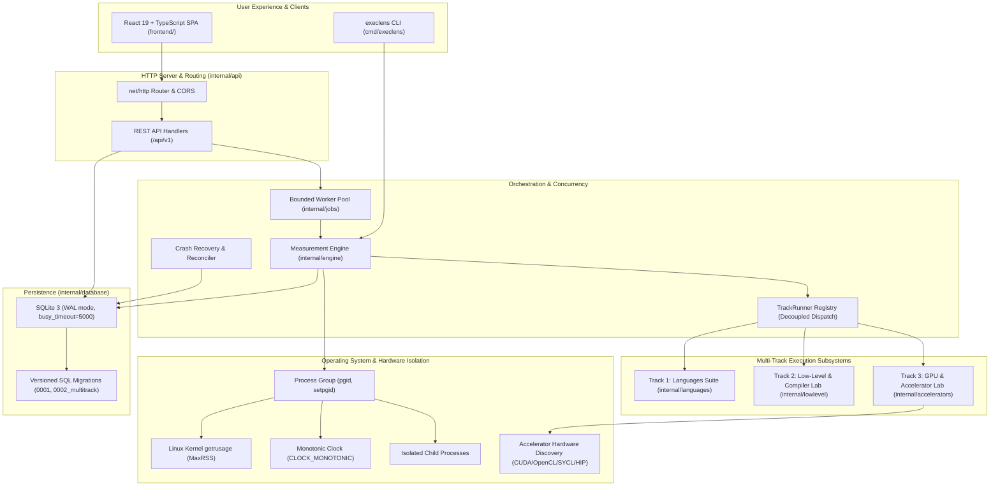

# ExecLens System Architecture

## Overview

**ExecLens** is a production-grade, open-source systems performance benchmarking platform engineered to measure and compare equivalent computational workloads across programming languages, CPU micro-architectural configurations, and GPU accelerators under controlled, transparent, and reproducible conditions.



---

## 1. Architectural Principles

1. **Separation of Compilation and Steady-State Execution**:
   Compilation and preparatory phases are tracked independently (`build_duration_ns`) and never conflated with steady-state algorithmic execution duration.
2. **Deterministic Correctness Validation**:
   Prior to recording any timed repetitions, the execution engine validates output correctness against an expected contract. If validation fails, timing is rejected and marked `FAILED`.
3. **Transparent Statistics & Noise Awareness**:
   ExecLens reports central tendencies (median and mean), sample standard deviation, coefficient of variation (CV%), and Student's t 95% confidence intervals. It flags whether observed differences exceed practical thresholds (5%) or are within measurement noise.
4. **Security & Process Boundaries**:
   Subprocesses are invoked via fixed binary paths and argument vectors (no shell string interpolation). Child processes are isolated in separate process groups (`setpgid: true`) to ensure that cancellations and timeouts immediately clean up the entire process tree without leaving orphaned processes.
5. **Decoupled Multi-Track Dispatch via `TrackRunner`**:
   To prevent circular package dependencies between the central engine and specialized domain modules (`lowlevel`, `accelerators`), ExecLens employs an inversion-of-control registry pattern. Tracks register a `TrackRunner` interface implementation during initialization.
6. **Honest Accelerator Reporting**:
   ExecLens detects hardware devices, drivers, and compiler toolchains at runtime. When hardware is absent or incompatible (e.g. driver/toolkit architecture mismatch), it reports the diagnostic reason transparently—never fabricating numbers or silently substituting CPU execution.

---

## 2. Component Breakdown

### A. CLI (`cmd/execlens`)
The unified command-line entry point supporting:
- `execlens server`: Starts the REST API service and embedded dashboard.
- `execlens run`: Directly executes multi-language benchmark workloads.
- `execlens lowlevel`: Executes CPU micro-architectural and compiler optimization benchmarks.
- `execlens cuda`: Executes GPU CUDA benchmarks with CPU reference comparisons.
- `execlens accelerators`: Inspects detected accelerator backends (CUDA, OpenCL, SYCL, HIP).
- `execlens languages`: Probes host compilers and runtimes.
- `execlens workloads`: Inspects the workload catalog.
- `execlens list`: Queries past benchmark runs.
- `execlens report <id>`: Displays detailed markdown reports.
- `execlens export <id> --format=json|csv`: Generates data exports.

### B. REST API Layer (`internal/api`)
Built using Go standard library HTTP routing with parameter validation:
- `GET /api/v1/health`: Service health status.
- `GET /api/v1/stats`: Summary counters and active runtimes across all tracks.
- `GET /api/v1/tracks`: Multi-track overview, active catalog, and hardware status.
- `GET /api/v1/languages`: Supported languages and host toolchain versions.
- `GET /api/v1/workloads`: Catalog of cross-language benchmark workloads.
- `GET /api/v1/lowlevel/catalog`: Catalog of CPU low-level workloads, variants, and compilers.
- `GET /api/v1/accelerators`: Probed accelerator devices and diagnostic notes.
- `GET /api/v1/accelerators/catalog`: Catalog of GPU accelerator workloads and metrics.
- `GET /api/v1/runs`: Paginated benchmark history with optional track and status filters.
- `POST /api/v1/runs`: Input validation, creates run and enqueues to worker pool.
- `GET /api/v1/runs/{runId}`: Retrieves run details, metrics, compiler assembly, and GPU telemetry.
- `POST /api/v1/runs/{runId}/cancel`: Cancels active benchmark jobs.
- `GET /api/v1/runs/{runId}/export?format=json|csv`: Data export.
- `GET /api/v1/runs/{runId}/report`: Formatted Markdown report.
- `GET /api/v1/compare?run_ids=...`: Side-by-side run comparison with compatibility checks.

### C. Bounded Worker Pool (`internal/jobs`)
Limits concurrent benchmark executions (default: 1) to eliminate CPU core contention and cache thrashing. Coordinates job lifecycle, supports graceful context cancellation, and traps unexpected worker panics to prevent service termination.

### D. Measurement Engine & Decoupled Track Dispatch (`internal/engine`)
The measurement engine manages the execution lifecycle:
```go
type TrackRunner interface {
    RunTrack(ctx context.Context, run *database.Run, db *database.DB, updateProgress func(pct int, stage string)) error
}
```
During program startup, specialized runners register themselves:
- `engine.RegisterTrackRunner("lowlevel", lowlevel.NewRunner(...))`
- `engine.RegisterTrackRunner("gpu", accelerators.NewCUDARunner(...))`

### E. Track 1: Languages Suite (`internal/languages`)
Modular adapter interface defining toolchain requirements, build commands, execution flags, timeouts, and warm-up policies for:
- **C++**: Native compiled execution via GCC/G++ `-O3 -std=c++20`.
- **Rust**: Native compiled execution via `rustc -C opt-level=3 -C codegen-units=1`.
- **Go**: Statically compiled binary via `go build -trimpath`.
- **Java**: JVM execution via OpenJDK `javac -d` and `java -XX:+TieredCompilation` with warm-up.
- **Python**: Interpreter execution via CPython `python3 -u`.
- **JavaScript**: V8 runtime execution via Node.js with warm-up.

### F. Track 2: Low-Level Code & Compiler Explorer Lab (`internal/lowlevel`)
Provides deep micro-architectural exploration and compiler inspection:
1. **Micro-Architectural Workloads (`benchmarks/lowlevel/`)**:
   - `reduction.cpp`: Scalar vs autovec vs explicit AVX2 SIMD intrinsics vs OpenMP vs inline x86_64 assembly.
   - `dot_product.cpp`: Double-precision dot product with AVX2+FMA (`_mm256_fmadd_pd`).
   - `layout_memory.cpp`: Array of Structures (AoS) vs Structure of Arrays (SoA) particle simulation.
   - `pointer_chase.cpp`: Contiguous memory streaming vs random cycle pointer chasing (prefetcher defeat).
   - `memory_copy.cpp`: glibc `memcpy` vs scalar byte loop vs 64-bit unrolled loop vs 32-byte aligned AVX2 non-temporal streaming stores (`_mm256_stream_si256` with `posix_memalign`).
2. **Compiler Explorer Pipeline**:
   - Compiles with GCC (`g++`) or Clang (`clang++`) under `-O0` to `-Ofast`.
   - Generates Intel-syntax assembly (`-S -masm=intel`).
   - Captures vectorization remarks (`-fopt-info-vec-optimized` for GCC, `-Rpass=loop-vectorize` for Clang).
   - Measures binary executable file size in bytes.

### G. Track 3: CUDA & GPU Compute Lab (`internal/accelerators`)
Provides GPU kernel measurement, hardware telemetry, and heterogeneous comparisons:
1. **Hardware & Toolchain Prober**:
   - Probes `nvidia-smi` and `nvcc --version`.
   - Detects GPU model, driver version, CUDA version, and Compute Capability.
   - Validates architecture support (e.g., handles cases where newer toolchains drop legacy architectures like CUDA 13.3 dropping Pascal `sm_61`).
   - Detects OpenCL (`clinfo`), SYCL (`icpx`), and ROCm/HIP (`hipcc`).
2. **Dedicated CUDA Workloads (`benchmarks/cuda/`)**:
   - `vec_add_saxpy.cu`: Vector addition and SAXPY.
   - `parallel_reduction.cu`: Tree reduction with warp shuffle unrolling.
   - `matrix_mul.cu`: Naive global memory vs 16x16 tiled shared memory vs cache-blocked CPU reference.
   - `convolution_1d.cu`: 1D stencil convolution with shared memory halo caching.
   - `histogram_scan.cu`: 256-bin histogram using shared memory atomics.
   - `bandwidth_transfer.cu`: PCIe bandwidth comparison: Pageable vs Pinned memory (`cudaHostAlloc`).
3. **Timing & Metric Extraction**:
   - Synchronized kernel duration via `cudaEvent_t`.
   - Host-to-Device (H2D) and Device-to-Host (D2H) transfer durations.
   - Memory allocation duration (`cudaMalloc` / `cudaFree`).
   - Effective bandwidth (GB/s) and GFLOPS computation.
   - Side-by-side CPU reference baseline comparison.

### H. Database & Versioned Migrations (`internal/database`)
SQLite 3 database configured with Write-Ahead Logging (`WAL`), 5000ms busy timeout, and foreign key constraints:
- `0001_initial.sql`: Runs, Language Executions, and Benchmark Samples tables.
- `0002_multitrack.sql`: Adds `runs.track` index and columns for compiler flags, optimization level, target architecture, executable size, generated assembly, compiler remarks, and GPU execution metrics (`kernel_duration_ns`, `transfer_h2d_ns`, `transfer_d2h_ns`, `alloc_duration_ns`, `effective_bandwidth_gbps`, `gflops`, `gpu_device_name`, `gpu_compute_capability`, `gpu_driver_version`).

### I. Frontend Dashboard (`frontend/`)
Vite + React 19 + TypeScript application:
- Interactive multi-track launcher with live parameter customization.
- Results explorer with Recharts interactive charts (time, speedup, memory, throughput, bandwidth, GFLOPS).
- Assembly viewer with syntax highlighting and copy support.
- Compiler vectorizer remarks inspector.
- GPU execution breakdown telemetry bar.
- Side-by-side run comparison with compatibility warnings.
- Dark and Light mode themes.

