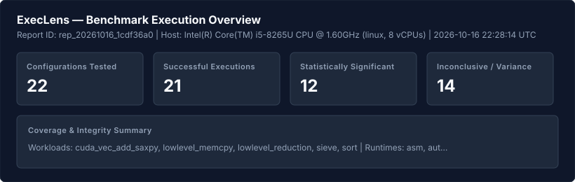
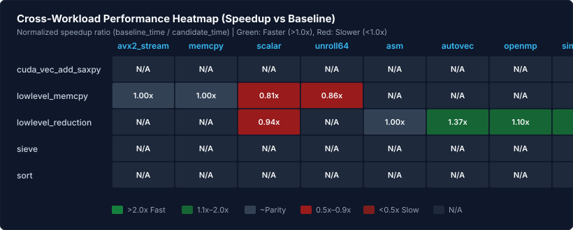
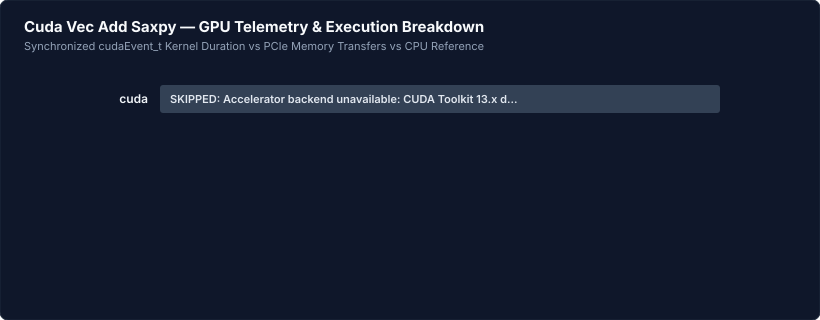
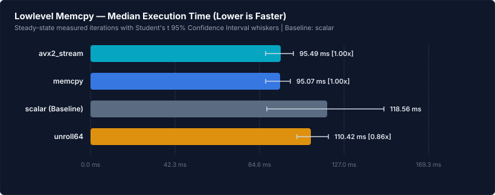
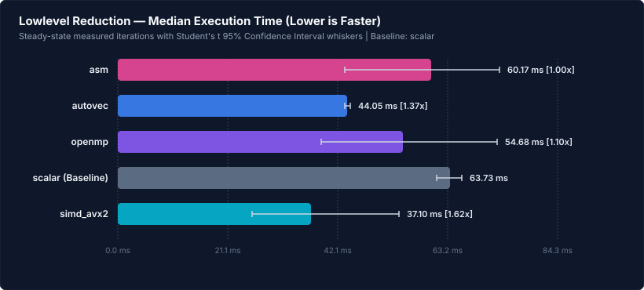
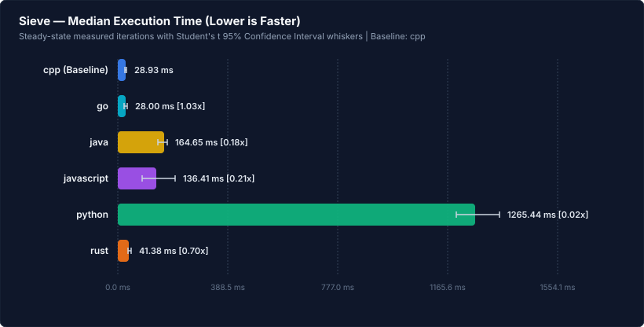
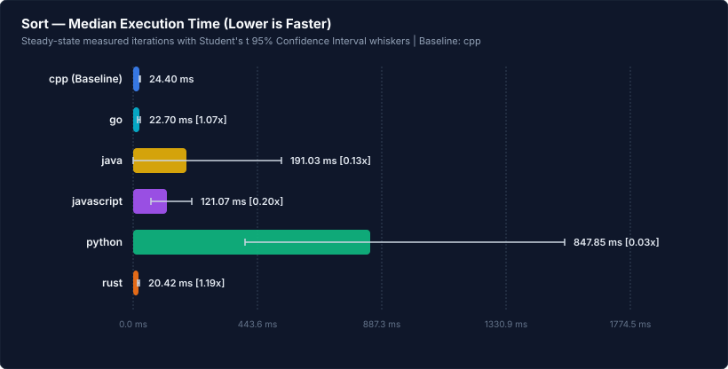

# ExecLens Performance Engineering Report

> **Measure fairly. Compare deeply. Understand why.**

- **Report ID**: `rep_20261016_1cdf36a0`
- **Generated At**: 2026-10-16T22:28:14Z
- **Generator Version**: `v1.0.0`
- **Git Revision**: `7e53c5e`
- **Host Environment**: linux (amd64, 8 vCPUs) | CPU: `Intel(R) Core(TM) i5-8265U CPU @ 1.60GHz`
- **Total Configurations Tested**: 22 (21 completed, 1 skipped/unavailable, 0 validation failures)

---

## 1. Executive Visual Summary



### Cross-Workload Performance Heatmap

The heatmap summarizes relative speedup normalized against the baseline across all tested workloads. Green cells denote accelerated performance; red cells denote slower execution; grey/dark cells denote statistical parity or unavailable toolchains.



---

## 2. Key Deterministic Performance Findings

The following findings were derived programmatically by the ExecLens Deterministic Findings Engine from verified sample distributions and Student's t 95% Confidence Intervals:

### find_001: Cuda Vec Add Saxpy Configuration Unavailable: cuda (SKIPPED)

- **Status**: ⚠️ **INCONCLUSIVE (HIGH VARIANCE)**
- **Workload & Scope**: `cuda_vec_add_saxpy` (Toolchain & Device Capability Validation)
- **Comparison**: `cuda` vs `cpp` baseline
- **Effect Size**: **SKIPPED** (N/A)
- **Explanation**: Execution cuda was marked SKIPPED. Accelerator backend unavailable: CUDA Toolkit 13.x dropped support for pre-Turing architectures (requires CC >= 7.5). Host device 'NVIDIA GeForce MX230' has Compute Capability 6.1 (Pascal), which is unsupported by the installed nvcc.
- **Caveat / Limitations**: *Reported transparently without silent fallback or fabricated values.*

### find_002: Lowlevel Memcpy Lowest Observed Median Runtime: memcpy

- **Status**: ✅ **STATISTICALLY SIGNIFICANT**
- **Workload & Scope**: `lowlevel_memcpy` (Lowlevel Memcpy (standard mode))
- **Comparison**: `memcpy` vs `scalar` baseline
- **Effect Size**: **95.07 ms** (95% CI [87.82, 100.06] ms, CV 2.6%)
- **Explanation**: memcpy recorded the lowest observed median execution time of 95.07 ms across 3 iterations.
- **Caveat / Limitations**: *Applies strictly to this specific workload, input configuration, and host environment.*

### find_003: Lowlevel Memcpy: Comparison Inconclusive for memcpy vs scalar

- **Status**: ⚠️ **INCONCLUSIVE (HIGH VARIANCE)**
- **Workload & Scope**: `lowlevel_memcpy` (Comparison against scalar baseline)
- **Comparison**: `memcpy` vs `scalar` baseline
- **Effect Size**: **1.25x** (Candidate 95% CI [87.82, 100.06] ms vs Baseline [88.31, 147.21] ms)
- **Explanation**: memcpy achieved median 95.07 ms vs scalar baseline 118.56 ms (1.25x relative speedup). Observed 19.8% median difference exceeds threshold, but confidence intervals overlap due to sample variance (noise).
- **Caveat / Limitations**: *Speedup is non-transferable across differing algorithmic patterns, I/O profiles, or unverified hardware configurations.*

### find_004: Lowlevel Memcpy: Comparison Inconclusive for avx2_stream vs scalar

- **Status**: ⚠️ **INCONCLUSIVE (HIGH VARIANCE)**
- **Workload & Scope**: `lowlevel_memcpy` (Comparison against scalar baseline)
- **Comparison**: `avx2_stream` vs `scalar` baseline
- **Effect Size**: **1.24x** (Candidate 95% CI [87.81, 101.80] ms vs Baseline [88.31, 147.21] ms)
- **Explanation**: avx2_stream achieved median 95.49 ms vs scalar baseline 118.56 ms (1.24x relative speedup). Observed 19.5% median difference exceeds threshold, but confidence intervals overlap due to sample variance (noise).
- **Caveat / Limitations**: *Speedup is non-transferable across differing algorithmic patterns, I/O profiles, or unverified hardware configurations.*

### find_005: Lowlevel Memcpy: Comparison Inconclusive for unroll64 vs scalar

- **Status**: ⚠️ **INCONCLUSIVE (HIGH VARIANCE)**
- **Workload & Scope**: `lowlevel_memcpy` (Comparison against scalar baseline)
- **Comparison**: `unroll64` vs `scalar` baseline
- **Effect Size**: **1.07x** (Candidate 95% CI [103.52, 119.22] ms vs Baseline [88.31, 147.21] ms)
- **Explanation**: unroll64 achieved median 110.42 ms vs scalar baseline 118.56 ms (1.07x relative speedup). Observed 6.9% median difference exceeds threshold, but confidence intervals overlap due to sample variance (noise).
- **Caveat / Limitations**: *Speedup is non-transferable across differing algorithmic patterns, I/O profiles, or unverified hardware configurations.*

### find_006: Lowlevel Memcpy Memory Efficiency: unroll64 Used 126.2 MB Peak RSS

- **Status**: 📊 **MEASURED**
- **Workload & Scope**: `lowlevel_memcpy` (Process Lifetime Peak Resident Set Size (MaxRSS))
- **Comparison**: `unroll64` vs `memcpy` baseline
- **Effect Size**: **126.2 MB (1.0x less)** (Captured directly from OS kernel getrusage.)
- **Explanation**: unroll64 demonstrated the lowest physical memory footprint (126.2 MB peak RSS) compared to memcpy (126.3 MB peak RSS, 1.0x difference).
- **Caveat / Limitations**: *Captures peak physical RSS of child process; does not isolate sub-allocator arena fragmentation from active working sets.*

### find_007: Lowlevel Reduction Lowest Observed Median Runtime: simd_avx2

- **Status**: ✅ **STATISTICALLY SIGNIFICANT**
- **Workload & Scope**: `lowlevel_reduction` (Lowlevel Reduction (standard mode))
- **Comparison**: `simd_avx2` vs `scalar` baseline
- **Effect Size**: **37.10 ms** (95% CI [25.85, 53.96] ms, CV 14.2%)
- **Explanation**: simd_avx2 recorded the lowest observed median execution time of 37.10 ms across 3 iterations.
- **Caveat / Limitations**: *Applies strictly to this specific workload, input configuration, and host environment.*

### find_008: Lowlevel Reduction: simd_avx2 Observed 1.72x Faster than scalar

- **Status**: ✅ **STATISTICALLY SIGNIFICANT**
- **Workload & Scope**: `lowlevel_reduction` (Comparison against scalar baseline)
- **Comparison**: `simd_avx2` vs `scalar` baseline
- **Effect Size**: **1.72x** (Candidate 95% CI [25.85, 53.96] ms vs Baseline [61.20, 65.93] ms)
- **Explanation**: simd_avx2 achieved median 37.10 ms vs scalar baseline 63.73 ms (1.72x relative speedup). Statistically significant difference with non-overlapping 95% confidence intervals (1.72x faster, 41.8% difference).
- **Caveat / Limitations**: *Speedup is non-transferable across differing algorithmic patterns, I/O profiles, or unverified hardware configurations.*

### find_009: Lowlevel Reduction: autovec Observed 1.45x Faster than scalar

- **Status**: ✅ **STATISTICALLY SIGNIFICANT**
- **Workload & Scope**: `lowlevel_reduction` (Comparison against scalar baseline)
- **Comparison**: `autovec` vs `scalar` baseline
- **Effect Size**: **1.45x** (Candidate 95% CI [43.61, 44.56] ms vs Baseline [61.20, 65.93] ms)
- **Explanation**: autovec achieved median 44.05 ms vs scalar baseline 63.73 ms (1.45x relative speedup). Statistically significant difference with non-overlapping 95% confidence intervals (1.45x faster, 30.9% difference).
- **Caveat / Limitations**: *Speedup is non-transferable across differing algorithmic patterns, I/O profiles, or unverified hardware configurations.*

### find_010: Lowlevel Reduction: Comparison Inconclusive for openmp vs scalar

- **Status**: ⚠️ **INCONCLUSIVE (HIGH VARIANCE)**
- **Workload & Scope**: `lowlevel_reduction` (Comparison against scalar baseline)
- **Comparison**: `openmp` vs `scalar` baseline
- **Effect Size**: **1.17x** (Candidate 95% CI [39.09, 72.83] ms vs Baseline [61.20, 65.93] ms)
- **Explanation**: openmp achieved median 54.68 ms vs scalar baseline 63.73 ms (1.17x relative speedup). Observed 14.2% median difference exceeds threshold, but confidence intervals overlap due to sample variance (noise).
- **Caveat / Limitations**: *Speedup is non-transferable across differing algorithmic patterns, I/O profiles, or unverified hardware configurations.*

### find_011: Lowlevel Reduction: Comparison Inconclusive for asm vs scalar

- **Status**: ⚠️ **INCONCLUSIVE (HIGH VARIANCE)**
- **Workload & Scope**: `lowlevel_reduction` (Comparison against scalar baseline)
- **Comparison**: `asm` vs `scalar` baseline
- **Effect Size**: **1.06x** (Candidate 95% CI [43.56, 73.29] ms vs Baseline [61.20, 65.93] ms)
- **Explanation**: asm achieved median 60.17 ms vs scalar baseline 63.73 ms (1.06x relative speedup). Observed 5.6% median difference exceeds threshold, but confidence intervals overlap due to sample variance (noise).
- **Caveat / Limitations**: *Speedup is non-transferable across differing algorithmic patterns, I/O profiles, or unverified hardware configurations.*

### find_012: Lowlevel Reduction Memory Efficiency: autovec Used 80.6 MB Peak RSS

- **Status**: 📊 **MEASURED**
- **Workload & Scope**: `lowlevel_reduction` (Process Lifetime Peak Resident Set Size (MaxRSS))
- **Comparison**: `autovec` vs `openmp` baseline
- **Effect Size**: **80.6 MB (1.0x less)** (Captured directly from OS kernel getrusage.)
- **Explanation**: autovec demonstrated the lowest physical memory footprint (80.6 MB peak RSS) compared to openmp (80.6 MB peak RSS, 1.0x difference).
- **Caveat / Limitations**: *Captures peak physical RSS of child process; does not isolate sub-allocator arena fragmentation from active working sets.*

### find_013: Sieve Lowest Observed Median Runtime: go

- **Status**: ✅ **STATISTICALLY SIGNIFICANT**
- **Workload & Scope**: `sieve` (Sieve (standard mode))
- **Comparison**: `go` vs `cpp` baseline
- **Effect Size**: **28.00 ms** (95% CI [23.82, 35.82] ms, CV 16.2%)
- **Explanation**: go recorded the lowest observed median execution time of 28.00 ms across 5 iterations.
- **Caveat / Limitations**: *Applies strictly to this specific workload, input configuration, and host environment.*

### find_014: Sieve: go Observed 1.03x Faster than cpp

- **Status**: 📊 **MEASURED**
- **Workload & Scope**: `sieve` (Comparison against cpp baseline)
- **Comparison**: `go` vs `cpp` baseline
- **Effect Size**: **1.03x** (Candidate 95% CI [23.82, 35.82] ms vs Baseline [26.58, 31.08] ms)
- **Explanation**: go achieved median 28.00 ms vs cpp baseline 28.93 ms (1.03x relative speedup). Observed 3.2% median difference is within 95% confidence interval overlap and below the 5.0% threshold.
- **Caveat / Limitations**: *Speedup is non-transferable across differing algorithmic patterns, I/O profiles, or unverified hardware configurations.*

### find_015: Sieve: rust Observed 1.43x Slower than cpp

- **Status**: ✅ **STATISTICALLY SIGNIFICANT**
- **Workload & Scope**: `sieve` (Comparison against cpp baseline)
- **Comparison**: `rust` vs `cpp` baseline
- **Effect Size**: **0.70x** (Candidate 95% CI [37.83, 48.09] ms vs Baseline [26.58, 31.08] ms)
- **Explanation**: rust achieved median 41.38 ms vs cpp baseline 28.93 ms (0.70x relative speedup). Statistically significant difference with non-overlapping 95% confidence intervals (1.43x slower, 43.0% difference).
- **Caveat / Limitations**: *Speedup is non-transferable across differing algorithmic patterns, I/O profiles, or unverified hardware configurations.*

### find_016: Sieve: javascript Observed 4.71x Slower than cpp

- **Status**: ✅ **STATISTICALLY SIGNIFICANT**
- **Workload & Scope**: `sieve` (Comparison against cpp baseline)
- **Comparison**: `javascript` vs `cpp` baseline
- **Effect Size**: **0.21x** (Candidate 95% CI [88.64, 203.73] ms vs Baseline [26.58, 31.08] ms)
- **Explanation**: javascript achieved median 136.41 ms vs cpp baseline 28.93 ms (0.21x relative speedup). Statistically significant difference with non-overlapping 95% confidence intervals (4.71x slower, 371.4% difference).
- **Caveat / Limitations**: *Speedup is non-transferable across differing algorithmic patterns, I/O profiles, or unverified hardware configurations.*

### find_017: Sieve: java Observed 5.69x Slower than cpp

- **Status**: ✅ **STATISTICALLY SIGNIFICANT**
- **Workload & Scope**: `sieve` (Comparison against cpp baseline)
- **Comparison**: `java` vs `cpp` baseline
- **Effect Size**: **0.18x** (Candidate 95% CI [142.16, 175.46] ms vs Baseline [26.58, 31.08] ms)
- **Explanation**: java achieved median 164.65 ms vs cpp baseline 28.93 ms (0.18x relative speedup). Statistically significant difference with non-overlapping 95% confidence intervals (5.69x slower, 469.1% difference).
- **Caveat / Limitations**: *Speedup is non-transferable across differing algorithmic patterns, I/O profiles, or unverified hardware configurations.*

### find_018: Sieve: python Observed 43.74x Slower than cpp

- **Status**: ✅ **STATISTICALLY SIGNIFICANT**
- **Workload & Scope**: `sieve` (Comparison against cpp baseline)
- **Comparison**: `python` vs `cpp` baseline
- **Effect Size**: **0.02x** (Candidate 95% CI [1197.95, 1351.37] ms vs Baseline [26.58, 31.08] ms)
- **Explanation**: python achieved median 1265.44 ms vs cpp baseline 28.93 ms (0.02x relative speedup). Statistically significant difference with non-overlapping 95% confidence intervals (43.74x slower, 4273.6% difference).
- **Caveat / Limitations**: *Speedup is non-transferable across differing algorithmic patterns, I/O profiles, or unverified hardware configurations.*

### find_019: Sieve Memory Efficiency: cpp Used 21.7 MB Peak RSS

- **Status**: 📊 **MEASURED**
- **Workload & Scope**: `sieve` (Process Lifetime Peak Resident Set Size (MaxRSS))
- **Comparison**: `cpp` vs `javascript` baseline
- **Effect Size**: **21.7 MB (2.9x less)** (Captured directly from OS kernel getrusage.)
- **Explanation**: cpp demonstrated the lowest physical memory footprint (21.7 MB peak RSS) compared to javascript (62.3 MB peak RSS, 2.9x difference).
- **Caveat / Limitations**: *Captures peak physical RSS of child process; does not isolate sub-allocator arena fragmentation from active working sets.*

### find_020: Sieve Stability Notice: High Measurement Variance in go (CV 16.2%)

- **Status**: ⚠️ **INCONCLUSIVE (HIGH VARIANCE)**
- **Workload & Scope**: `sieve` (Inter-sample coefficient of variation)
- **Comparison**: `go` vs `cpp` baseline
- **Effect Size**: **16.2%** (StdDev ±4.83 ms across 5 samples)
- **Explanation**: go showed high dispersion across iterations (StdDev ±4.83 ms, CV 16.2% exceeding the 15% threshold).
- **Caveat / Limitations**: *High variance indicates JIT compilation de-optimization, garbage collection pauses, or background OS core scheduling preemption.*

### find_021: Sieve Stability Notice: High Measurement Variance in javascript (CV 31.7%)

- **Status**: ⚠️ **INCONCLUSIVE (HIGH VARIANCE)**
- **Workload & Scope**: `sieve` (Inter-sample coefficient of variation)
- **Comparison**: `javascript` vs `cpp` baseline
- **Effect Size**: **31.7%** (StdDev ±46.35 ms across 5 samples)
- **Explanation**: javascript showed high dispersion across iterations (StdDev ±46.35 ms, CV 31.7% exceeding the 15% threshold).
- **Caveat / Limitations**: *High variance indicates JIT compilation de-optimization, garbage collection pauses, or background OS core scheduling preemption.*

### find_022: Sort Lowest Observed Median Runtime: rust

- **Status**: ✅ **STATISTICALLY SIGNIFICANT**
- **Workload & Scope**: `sort` (Sort (quicksort mode))
- **Comparison**: `rust` vs `cpp` baseline
- **Effect Size**: **20.42 ms** (95% CI [18.94, 22.73] ms, CV 3.7%)
- **Explanation**: rust recorded the lowest observed median execution time of 20.42 ms across 3 iterations.
- **Caveat / Limitations**: *Applies strictly to this specific workload, input configuration, and host environment.*

### find_023: Sort: Comparison Inconclusive for rust vs cpp

- **Status**: ⚠️ **INCONCLUSIVE (HIGH VARIANCE)**
- **Workload & Scope**: `sort` (Comparison against cpp baseline)
- **Comparison**: `rust` vs `cpp` baseline
- **Effect Size**: **1.19x** (Candidate 95% CI [18.94, 22.73] ms vs Baseline [22.63, 26.42] ms)
- **Explanation**: rust achieved median 20.42 ms vs cpp baseline 24.40 ms (1.19x relative speedup). Observed 16.3% median difference exceeds threshold, but confidence intervals overlap due to sample variance (noise).
- **Caveat / Limitations**: *Speedup is non-transferable across differing algorithmic patterns, I/O profiles, or unverified hardware configurations.*

### find_024: Sort: Comparison Inconclusive for go vs cpp

- **Status**: ⚠️ **INCONCLUSIVE (HIGH VARIANCE)**
- **Workload & Scope**: `sort` (Comparison against cpp baseline)
- **Comparison**: `go` vs `cpp` baseline
- **Effect Size**: **1.07x** (Candidate 95% CI [18.72, 26.15] ms vs Baseline [22.63, 26.42] ms)
- **Explanation**: go achieved median 22.70 ms vs cpp baseline 24.40 ms (1.07x relative speedup). Observed 7.0% median difference exceeds threshold, but confidence intervals overlap due to sample variance (noise).
- **Caveat / Limitations**: *Speedup is non-transferable across differing algorithmic patterns, I/O profiles, or unverified hardware configurations.*

### find_025: Sort: javascript Observed 4.96x Slower than cpp

- **Status**: ✅ **STATISTICALLY SIGNIFICANT**
- **Workload & Scope**: `sort` (Comparison against cpp baseline)
- **Comparison**: `javascript` vs `cpp` baseline
- **Effect Size**: **0.20x** (Candidate 95% CI [64.69, 210.54] ms vs Baseline [22.63, 26.42] ms)
- **Explanation**: javascript achieved median 121.07 ms vs cpp baseline 24.40 ms (0.20x relative speedup). Statistically significant difference with non-overlapping 95% confidence intervals (4.96x slower, 396.2% difference).
- **Caveat / Limitations**: *Speedup is non-transferable across differing algorithmic patterns, I/O profiles, or unverified hardware configurations.*

### find_026: Sort: Comparison Inconclusive for java vs cpp

- **Status**: ⚠️ **INCONCLUSIVE (HIGH VARIANCE)**
- **Workload & Scope**: `sort` (Comparison against cpp baseline)
- **Comparison**: `java` vs `cpp` baseline
- **Effect Size**: **0.13x** (Candidate 95% CI [0.00, 532.15] ms vs Baseline [22.63, 26.42] ms)
- **Explanation**: java achieved median 191.03 ms vs cpp baseline 24.40 ms (0.13x relative speedup). Observed 682.9% median difference exceeds threshold, but confidence intervals overlap due to sample variance (noise).
- **Caveat / Limitations**: *Speedup is non-transferable across differing algorithmic patterns, I/O profiles, or unverified hardware configurations.*

### find_027: Sort: python Observed 34.75x Slower than cpp

- **Status**: ✅ **STATISTICALLY SIGNIFICANT**
- **Workload & Scope**: `sort` (Comparison against cpp baseline)
- **Comparison**: `python` vs `cpp` baseline
- **Effect Size**: **0.03x** (Candidate 95% CI [402.35, 1543.05] ms vs Baseline [22.63, 26.42] ms)
- **Explanation**: python achieved median 847.85 ms vs cpp baseline 24.40 ms (0.03x relative speedup). Statistically significant difference with non-overlapping 95% confidence intervals (34.75x slower, 3374.9% difference).
- **Caveat / Limitations**: *Speedup is non-transferable across differing algorithmic patterns, I/O profiles, or unverified hardware configurations.*

### find_028: Sort Memory Efficiency: cpp Used 16.9 MB Peak RSS

- **Status**: 📊 **MEASURED**
- **Workload & Scope**: `sort` (Process Lifetime Peak Resident Set Size (MaxRSS))
- **Comparison**: `cpp` vs `javascript` baseline
- **Effect Size**: **16.9 MB (3.7x less)** (Captured directly from OS kernel getrusage.)
- **Explanation**: cpp demonstrated the lowest physical memory footprint (16.9 MB peak RSS) compared to javascript (62.3 MB peak RSS, 3.7x difference).
- **Caveat / Limitations**: *Captures peak physical RSS of child process; does not isolate sub-allocator arena fragmentation from active working sets.*

### find_029: Sort Stability Notice: High Measurement Variance in python (CV 23.6%)

- **Status**: ⚠️ **INCONCLUSIVE (HIGH VARIANCE)**
- **Workload & Scope**: `sort` (Inter-sample coefficient of variation)
- **Comparison**: `python` vs `cpp` baseline
- **Effect Size**: **23.6%** (StdDev ±229.58 ms across 3 samples)
- **Explanation**: python showed high dispersion across iterations (StdDev ±229.58 ms, CV 23.6% exceeding the 15% threshold).
- **Caveat / Limitations**: *High variance indicates JIT compilation de-optimization, garbage collection pauses, or background OS core scheduling preemption.*

### find_030: Sort Stability Notice: High Measurement Variance in java (CV 47.0%)

- **Status**: ⚠️ **INCONCLUSIVE (HIGH VARIANCE)**
- **Workload & Scope**: `sort` (Inter-sample coefficient of variation)
- **Comparison**: `java` vs `cpp` baseline
- **Effect Size**: **47.0%** (StdDev ±115.40 ms across 3 samples)
- **Explanation**: java showed high dispersion across iterations (StdDev ±115.40 ms, CV 47.0% exceeding the 15% threshold).
- **Caveat / Limitations**: *High variance indicates JIT compilation de-optimization, garbage collection pauses, or background OS core scheduling preemption.*

### find_031: Sort Stability Notice: High Measurement Variance in javascript (CV 21.3%)

- **Status**: ⚠️ **INCONCLUSIVE (HIGH VARIANCE)**
- **Workload & Scope**: `sort` (Inter-sample coefficient of variation)
- **Comparison**: `javascript` vs `cpp` baseline
- **Effect Size**: **21.3%** (StdDev ±29.35 ms across 3 samples)
- **Explanation**: javascript showed high dispersion across iterations (StdDev ±29.35 ms, CV 21.3% exceeding the 15% threshold).
- **Caveat / Limitations**: *High variance indicates JIT compilation de-optimization, garbage collection pauses, or background OS core scheduling preemption.*

---

## 3. Workload-by-Workload Detailed Results

### Workload: Cuda Vec Add Saxpy (`cuda_vec_add_saxpy`)

- **Track**: `accelerator` | **Execution Mode**: `standard` | **Baseline**: `cpp`
- **Workload Parameters**: `{}`



| Implementation | Status | Median (ms) | Mean (ms) | 95% CI (ms) | StdDev (CV%) | Peak RSS | Throughput | Relative Speedup |
| :--- | :--- | :--- | :--- | :--- | :--- | :--- | :--- | :--- |
| **cuda** | SKIPPED | N/A | N/A | N/A | N/A | 0.0 MB | N/A | N/A |

<details>
<summary>Inspect Execution Notes, Toolchain Flags & Compiler Remarks</summary>

#### cuda (``)
- **Diagnostic Message**: Accelerator backend unavailable: CUDA Toolkit 13.x dropped support for pre-Turing architectures (requires CC >= 7.5). Host device 'NVIDIA GeForce MX230' has Compute Capability 6.1 (Pascal), which is unsupported by the installed nvcc.

</details>

---

### Workload: Lowlevel Memcpy (`lowlevel_memcpy`)

- **Track**: `lowlevel` | **Execution Mode**: `standard` | **Baseline**: `scalar`
- **Workload Parameters**: `{}`



| Implementation | Status | Median (ms) | Mean (ms) | 95% CI (ms) | StdDev (CV%) | Peak RSS | Throughput | Relative Speedup |
| :--- | :--- | :--- | :--- | :--- | :--- | :--- | :--- | :--- |
| **avx2_stream** | COMPLETED | 95.49 | 94.81 | [87.81, 101.80] | ±2.82 (3.0%) | 126.2 MB | 670201112 ops/s | **1.00x** |
| **memcpy** | COMPLETED | 95.07 | 93.94 | [87.82, 100.06] | ±2.46 (2.6%) | 126.3 MB | 673213245 ops/s | **1.00x** |
| **scalar** | COMPLETED | 118.56 | 117.76 | [88.31, 147.21] | ±11.85 (10.1%) | 126.2 MB | 539820956 ops/s | 1.00x (Baseline) |
| **unroll64** | COMPLETED | 110.42 | 111.37 | [103.52, 119.22] | ±3.16 (2.8%) | 126.2 MB | 579618823 ops/s | **0.86x** |

<details>
<summary>Inspect Execution Notes, Toolchain Flags & Compiler Remarks</summary>

#### avx2_stream (``)
- **Compiler Flags**: `-O3 -std=c++20 -mavx2 -mfma` (Opt: `-O3`)
- **Build Duration**: 2333.4 ms | **Binary Size**: 22432 bytes
- **Compiler Remarks**:
```
benchmarks/lowlevel/memory_copy.cpp:28:18: optimized: loop vectorized using 32 byte vectors and unroll factor 1
benchmarks/lowlevel/memory_copy.cpp:118:26: optimized: loop vectorized using 32 byte vectors and unroll factor 32
benchmarks/lowlevel/memory_copy.cpp:118:26: optimized: epilogue loop vectorized using 16 byte vectors and unroll factor 16
benchmarks/lowlevel/memory_copy.cpp:90:26: optimized: loop vectorized using 32 byte vectors and unroll factor 32
benchmarks/lowlevel/memory_copy.cpp:90:26: optimized: epilogue loop vectorized using 16 byte vectors and unroll factor 16
```

#### memcpy (``)
- **Compiler Flags**: `-O3 -std=c++20 -mavx2 -mfma` (Opt: `-O3`)
- **Build Duration**: 2716.5 ms | **Binary Size**: 22432 bytes
- **Compiler Remarks**:
```
benchmarks/lowlevel/memory_copy.cpp:28:18: optimized: loop vectorized using 32 byte vectors and unroll factor 1
benchmarks/lowlevel/memory_copy.cpp:118:26: optimized: loop vectorized using 32 byte vectors and unroll factor 32
benchmarks/lowlevel/memory_copy.cpp:118:26: optimized: epilogue loop vectorized using 16 byte vectors and unroll factor 16
benchmarks/lowlevel/memory_copy.cpp:90:26: optimized: loop vectorized using 32 byte vectors and unroll factor 32
benchmarks/lowlevel/memory_copy.cpp:90:26: optimized: epilogue loop vectorized using 16 byte vectors and unroll factor 16
```

#### scalar (``)
- **Compiler Flags**: `-O3 -std=c++20 -mavx2 -mfma` (Opt: `-O3`)
- **Build Duration**: 2242.9 ms | **Binary Size**: 22432 bytes
- **Compiler Remarks**:
```
benchmarks/lowlevel/memory_copy.cpp:28:18: optimized: loop vectorized using 32 byte vectors and unroll factor 1
benchmarks/lowlevel/memory_copy.cpp:118:26: optimized: loop vectorized using 32 byte vectors and unroll factor 32
benchmarks/lowlevel/memory_copy.cpp:118:26: optimized: epilogue loop vectorized using 16 byte vectors and unroll factor 16
benchmarks/lowlevel/memory_copy.cpp:90:26: optimized: loop vectorized using 32 byte vectors and unroll factor 32
benchmarks/lowlevel/memory_copy.cpp:90:26: optimized: epilogue loop vectorized using 16 byte vectors and unroll factor 16
```

#### unroll64 (``)
- **Compiler Flags**: `-O3 -std=c++20 -mavx2 -mfma` (Opt: `-O3`)
- **Build Duration**: 2285.6 ms | **Binary Size**: 22432 bytes
- **Compiler Remarks**:
```
benchmarks/lowlevel/memory_copy.cpp:28:18: optimized: loop vectorized using 32 byte vectors and unroll factor 1
benchmarks/lowlevel/memory_copy.cpp:118:26: optimized: loop vectorized using 32 byte vectors and unroll factor 32
benchmarks/lowlevel/memory_copy.cpp:118:26: optimized: epilogue loop vectorized using 16 byte vectors and unroll factor 16
benchmarks/lowlevel/memory_copy.cpp:90:26: optimized: loop vectorized using 32 byte vectors and unroll factor 32
benchmarks/lowlevel/memory_copy.cpp:90:26: optimized: epilogue loop vectorized using 16 byte vectors and unroll factor 16
```

</details>

---

### Workload: Lowlevel Reduction (`lowlevel_reduction`)

- **Track**: `lowlevel` | **Execution Mode**: `standard` | **Baseline**: `scalar`
- **Workload Parameters**: `{}`



| Implementation | Status | Median (ms) | Mean (ms) | 95% CI (ms) | StdDev (CV%) | Peak RSS | Throughput | Relative Speedup |
| :--- | :--- | :--- | :--- | :--- | :--- | :--- | :--- | :--- |
| **asm** | COMPLETED | 60.17 | 58.43 | [43.56, 73.29] | ±5.98 (10.2%) | 80.6 MB | 166205203 ops/s | **1.00x** |
| **autovec** | COMPLETED | 44.05 | 44.09 | [43.61, 44.56] | ±0.19 (0.4%) | 80.6 MB | 227038702 ops/s | **1.37x** |
| **openmp** | COMPLETED | 54.68 | 55.96 | [39.09, 72.83] | ±6.79 (12.1%) | 80.6 MB | 182887335 ops/s | **1.10x** |
| **scalar** | COMPLETED | 63.73 | 63.57 | [61.20, 65.93] | ±0.95 (1.5%) | 80.6 MB | 156903003 ops/s | 1.00x (Baseline) |
| **simd_avx2** | COMPLETED | 37.10 | 39.90 | [25.85, 53.96] | ±5.66 (14.2%) | 80.6 MB | 269567326 ops/s | **1.62x** |

<details>
<summary>Inspect Execution Notes, Toolchain Flags & Compiler Remarks</summary>

#### asm (``)
- **Compiler Flags**: `-O3 -std=c++20 -mavx2 -mfma` (Opt: `-O3`)
- **Build Duration**: 2397.4 ms | **Binary Size**: 26856 bytes
- **Compiler Remarks**:
```
benchmarks/lowlevel/reduction.cpp:87:22: optimized: loop vectorized using 32 byte vectors and unroll factor 4
benchmarks/lowlevel/reduction.cpp:39:22: optimized: loop vectorized using 32 byte vectors and unroll factor 4
```

#### autovec (``)
- **Compiler Flags**: `-O3 -std=c++20 -mavx2 -mfma` (Opt: `-O3`)
- **Build Duration**: 3038.3 ms | **Binary Size**: 26856 bytes
- **Compiler Remarks**:
```
benchmarks/lowlevel/reduction.cpp:87:22: optimized: loop vectorized using 32 byte vectors and unroll factor 4
benchmarks/lowlevel/reduction.cpp:39:22: optimized: loop vectorized using 32 byte vectors and unroll factor 4
```

#### openmp (``)
- **Compiler Flags**: `-O3 -std=c++20 -mavx2 -mfma` (Opt: `-O3`)
- **Build Duration**: 2908.6 ms | **Binary Size**: 26856 bytes
- **Compiler Remarks**:
```
benchmarks/lowlevel/reduction.cpp:87:22: optimized: loop vectorized using 32 byte vectors and unroll factor 4
benchmarks/lowlevel/reduction.cpp:39:22: optimized: loop vectorized using 32 byte vectors and unroll factor 4
```

#### scalar (``)
- **Compiler Flags**: `-O3 -std=c++20 -mavx2 -mfma` (Opt: `-O3`)
- **Build Duration**: 3300.7 ms | **Binary Size**: 26856 bytes
- **Compiler Remarks**:
```
benchmarks/lowlevel/reduction.cpp:87:22: optimized: loop vectorized using 32 byte vectors and unroll factor 4
benchmarks/lowlevel/reduction.cpp:39:22: optimized: loop vectorized using 32 byte vectors and unroll factor 4
```

#### simd_avx2 (``)
- **Compiler Flags**: `-O3 -std=c++20 -mavx2 -mfma` (Opt: `-O3`)
- **Build Duration**: 2219.4 ms | **Binary Size**: 26856 bytes
- **Compiler Remarks**:
```
benchmarks/lowlevel/reduction.cpp:87:22: optimized: loop vectorized using 32 byte vectors and unroll factor 4
benchmarks/lowlevel/reduction.cpp:39:22: optimized: loop vectorized using 32 byte vectors and unroll factor 4
```

</details>

---

### Workload: Sieve (`sieve`)

- **Track**: `languages` | **Execution Mode**: `standard` | **Baseline**: `cpp`
- **Workload Parameters**: `{"limit":5000000}`



| Implementation | Status | Median (ms) | Mean (ms) | 95% CI (ms) | StdDev (CV%) | Peak RSS | Throughput | Relative Speedup |
| :--- | :--- | :--- | :--- | :--- | :--- | :--- | :--- | :--- |
| **cpp** | COMPLETED | 28.93 | 28.83 | [26.58, 31.08] | ±1.81 (6.3%) | 21.7 MB | 172808428 ops/s | 1.00x (Baseline) |
| **go** | COMPLETED | 28.00 | 29.82 | [23.82, 35.82] | ±4.83 (16.2%) | 26.7 MB | 178571958 ops/s | **1.03x** |
| **java** | COMPLETED | 164.65 | 158.81 | [142.16, 175.46] | ±13.41 (8.4%) | 50.3 MB | 30366540 ops/s | **0.18x** |
| **javascript** | COMPLETED | 136.41 | 146.19 | [88.64, 203.73] | ±46.35 (31.7%) | 62.3 MB | 36655284 ops/s | **0.21x** |
| **python** | COMPLETED | 1265.44 | 1274.66 | [1197.95, 1351.37] | ±61.79 (4.8%) | 26.9 MB | 3951187 ops/s | **0.02x** |
| **rust** | COMPLETED | 41.38 | 42.96 | [37.83, 48.09] | ±4.13 (9.6%) | 26.9 MB | 120841774 ops/s | **0.70x** |

<details>
<summary>Inspect Execution Notes, Toolchain Flags & Compiler Remarks</summary>

#### cpp (`g++ (GCC) 16.2.1 20260810`)
- **Build Duration**: 1156.6 ms | **Binary Size**: 0 bytes

#### go (`go version go1.27.1 linux/amd64`)
- **Build Duration**: 227.7 ms | **Binary Size**: 0 bytes

#### java (`javac 27`)
- **Build Duration**: 1093.8 ms | **Binary Size**: 0 bytes

#### javascript (`v26.10.0`)

#### python (`Python 3.14.8`)

#### rust (`rustc 1.97.1 (8bab26f4f 2026-07-14)`)
- **Build Duration**: 202.1 ms | **Binary Size**: 0 bytes

</details>

---

### Workload: Sort (`sort`)

- **Track**: `languages` | **Execution Mode**: `quicksort` | **Baseline**: `cpp`
- **Workload Parameters**: `{"mode":"quicksort","size":200000}`



| Implementation | Status | Median (ms) | Mean (ms) | 95% CI (ms) | StdDev (CV%) | Peak RSS | Throughput | Relative Speedup |
| :--- | :--- | :--- | :--- | :--- | :--- | :--- | :--- | :--- |
| **cpp** | COMPLETED | 24.40 | 24.53 | [22.63, 26.42] | ±0.76 (3.1%) | 16.9 MB | 8196948 ops/s | 1.00x (Baseline) |
| **go** | COMPLETED | 22.70 | 22.44 | [18.72, 26.15] | ±1.49 (6.7%) | 17.1 MB | 8811140 ops/s | **1.07x** |
| **java** | COMPLETED | 191.03 | 245.47 | [0.00, 532.15] | ±115.40 (47.0%) | 49.5 MB | 1046974 ops/s | **0.13x** |
| **javascript** | COMPLETED | 121.07 | 137.62 | [64.69, 210.54] | ±29.35 (21.3%) | 62.3 MB | 1651986 ops/s | **0.20x** |
| **python** | COMPLETED | 847.85 | 972.70 | [402.35, 1543.05] | ±229.58 (23.6%) | 23.2 MB | 235891 ops/s | **0.03x** |
| **rust** | COMPLETED | 20.42 | 20.83 | [18.94, 22.73] | ±0.76 (3.7%) | 20.3 MB | 9793639 ops/s | **1.19x** |

<details>
<summary>Inspect Execution Notes, Toolchain Flags & Compiler Remarks</summary>

#### cpp (`g++ (GCC) 16.2.1 20260810`)
- **Build Duration**: 1664.7 ms | **Binary Size**: 0 bytes

#### go (`go version go1.27.1 linux/amd64`)
- **Build Duration**: 214.7 ms | **Binary Size**: 0 bytes

#### java (`javac 27`)
- **Build Duration**: 916.8 ms | **Binary Size**: 0 bytes

#### javascript (`v26.10.0`)

#### python (`Python 3.14.8`)

#### rust (`rustc 1.97.1 (8bab26f4f 2026-07-14)`)
- **Build Duration**: 415.5 ms | **Binary Size**: 0 bytes

</details>

---

## 4. Methodology, Reproducibility & Provenance

ExecLens adheres to strict systems benchmarking methodology:
1. **Separation of Build & Runtime**: Compilation duration is tracked independently and never conflated with steady-state execution.
2. **Deterministic Correctness**: Outputs are validated against expected values before accepting timing samples.
3. **Kernel RSS Memory Tracking**: Memory reflects peak physical Resident Set Size (RSS) via Linux kernel `getrusage`.
4. **Statistical Rigor**: Reports Median, Student's t 95% Confidence Intervals, and sample Coefficient of Variation (CV%).

### Reproduction Command

To reproduce this exact benchmark report and all generated artifacts on your machine:

```bash
# Execute benchmarks and generate report
make benchmark-report
```

### Manifest & Raw Data Links

- [Reproducibility Manifest](manifest.json)
- [Aggregated Summary Dataset](summary.json)
- [Complete Raw Observations](raw-results.json)
- [Tabular Comparison CSV](comparison.csv)

---
*Generated by ExecLens Automated Benchmark Reporting System — Measure fairly. Compare deeply. Understand why.*
